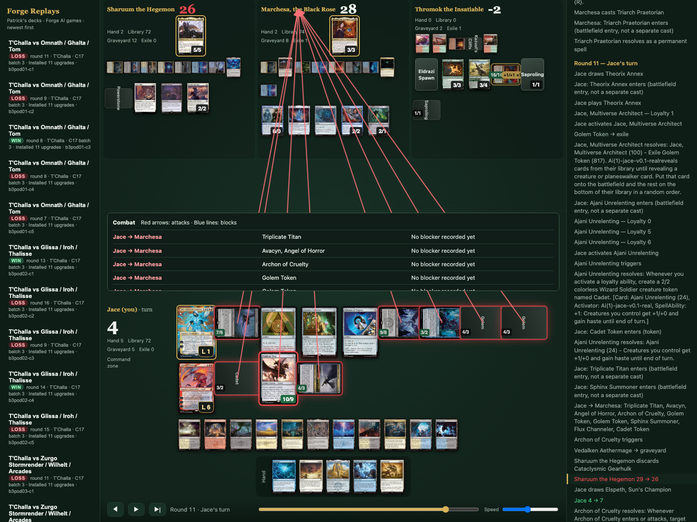
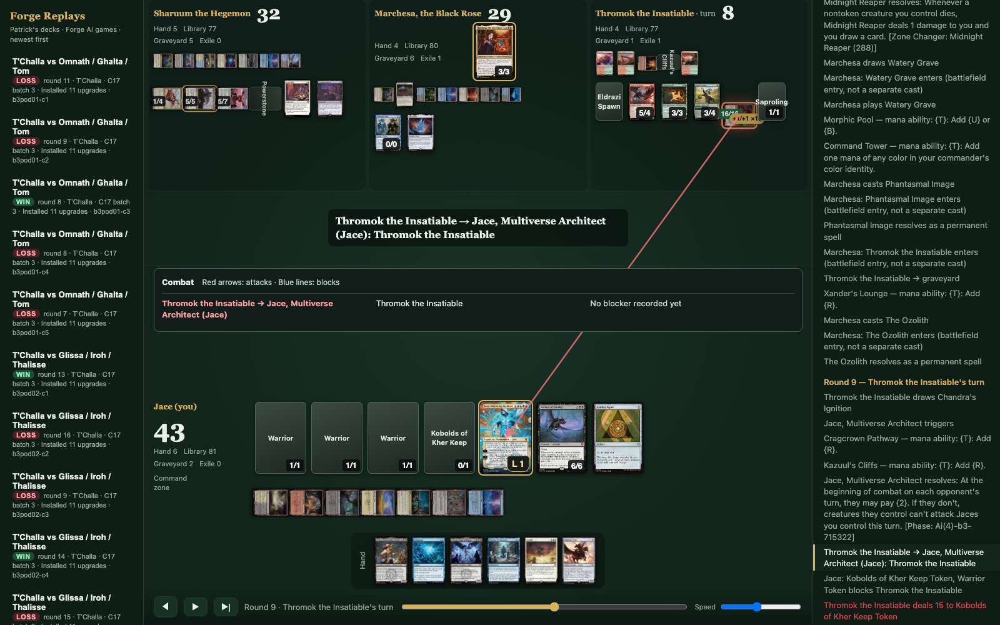
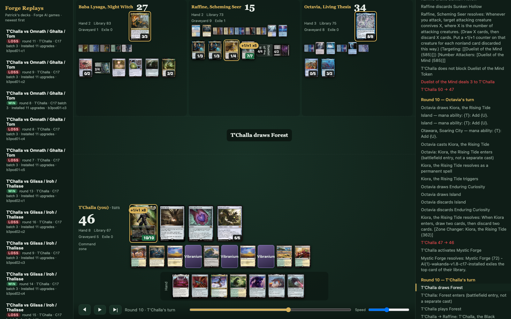

# MTG Deck Builder

A tool that has a computer play thousands of games of Magic: The Gathering with my decks, so I can see what works,
what doesn't, and which card changes really make a deck stronger.



## Why I made this

I had never played Magic before. I picked up two Commander decks and quickly found out how much there is to learn:
hundreds of cards, lots of rules, and endless advice online about which cards are "good". I couldn't tell whether my
decks were any good, why I was losing, or whether a card someone recommended would actually help.

So I built this project for three reasons:

1. **To understand my own decks.** I wanted to see how they actually play over hundreds of games, not just the few
   games I get to play with friends.
2. **To keep making them stronger.** I wanted every change to be tested, so I only buy and add cards that really
   help.
3. **To learn how to play Magic.** Watching the computer play my decks turn by turn, and seeing where it wins and
   where it loses, has taught me the game faster than reading rules ever did.

I have some coding background. I built this by describing what I wanted, in plain English, to two AI coding assistants:
**Claude Code** and **Codex**. They wrote the code and ran the tests, and they checked each other's work.

## A quick Magic primer

- **Magic: The Gathering** is a card game where players cast creatures and spells to bring their opponents' life
  total to zero.
- **Commander** is a popular way to play. Four players each bring a 100-card deck built around one legendary card,
  the "commander", and the last player standing wins.
- My two decks are led by **Jace, Multiverse Architect** and **T'Challa, the Black Panther**.
- A **planeswalker** is a powerful card that acts like an ally on your side. It has **loyalty** points it spends to
  use abilities, and it's defeated if opponents knock its loyalty down to zero.
- **Power level brackets** group decks by strength so games are fair. My decks and all their test opponents are
  "bracket 3", a common middle level.

## How it works

1. **Load my deck.** I copy my deck list from Moxfield (a popular deck-building website) and paste it in. The tool
   checks every card name and makes sure the deck follows the bracket's rules.
2. **Let the computer play.** It uses **Forge**, a free program that knows all of Magic's rules. Forge plays four
   computer players at once: my deck against three opponent decks. It plays 100 games or more in a row, recording
   every move.
3. **Find a starting score.** Out of 100 games, how many does my deck win? With four players, an average deck wins
   about **1 game in 4 (25%)**. Anything above that means the deck is stronger than average.
4. **Watch the games.** A replay viewer shows each game like a video: every card played, every attack, life totals,
   and what's in my hand. This is where I learn the most, because I can see exactly how a game was won or lost.
5. **Try small changes.** The AI assistants suggest swapping 1–3 cards to fix a specific weakness, like "we keep
   losing to big creatures that trample over us".
6. **Test fairly.** The changed deck replays the *exact same* games as the original: same opponents, same shuffles,
   same seats. If it wins more of those same games, the change really helped and it wasn't just luck.
7. **Double-check.** A second AI reviews every batch of 100 games before the next batch starts, looking for mistakes
   or anything odd.
8. **Play it for real.** I only buy and add the cards that tested well, then see how they feel at a real table.

## What the screenshots show

**Protecting a planeswalker.** An opponent's creature attacks my Jace planeswalker, which has just 1 loyalty left. A
small token creature jumps in front to block, and Jace survives.



**T'Challa growing.** Every time my T'Challa deck casts a big artifact, T'Challa gets bigger. Here he's grown from a
small creature into a 10/10 with eight +1/+1 counters.



How to read a screenshot: the three opponents are along the top with their life totals; my side of the board is at
the bottom with my hand below it; the play-by-play runs down the right side; red arrows are attacks.

## What I've learned so far

- **My T'Challa deck got clearly stronger.** It played 500 games before 11 card upgrades and 500 after, all the same
  games. It went from **84 wins to 117 wins**, from about 1 win in 6 games to nearly 1 in 4. A gap that large almost
  never happens by chance.
- **My Jace deck is already above average.** It won **159 of 500 games (about 32%)** against five different groups of
  opponents. None of the card swaps we tried has beaten it yet. That told me the deck was better than I thought and
  saved me from buying cards I didn't need.
- **A few games prove nothing.** Winning 4 out of 10 games can happen by pure luck. Real answers take hundreds of
  games played the same way.
- **The computer isn't a person.** Forge's computer players misuse some cards or never play them at all. For those
  cards, my own games are the better test.

## The step-by-step guide

[DECK-WORKFLOW.md](DECK-WORKFLOW.md) walks through the full process for a new deck. Day to day I just type simple
requests to the AI assistants, like "here's my new deck", "how is the test going?" or "show me the last 10 games".

**You don't need both AI assistants.** If you don't have Codex, Claude can do everything on its own, including the
second-opinion review, which it runs as a separate, independent session.

## Credits

- [Forge](https://github.com/Card-Forge/forge), the free open-source Magic rules engine that plays the games.
- Card images from [Scryfall](https://scryfall.com). Card names and art are © Wizards of the Coast. This is an
  unofficial fan project, not made or endorsed by Wizards of the Coast.
- Built with [Claude Code](https://claude.com/claude-code) and Codex.

---

## For technical readers: setup

Requirements: macOS or Linux, Java 21, Node 18+, Python 3.10+, and roughly 3 GB of RAM per game running at once.

1. Clone into `~/Projects/mtg-commander`. A few scripts still assume this path.
2. Install the Forge 2.0.15 desktop release into `forge/app/`. It isn't included in this repository.
3. Build the custom card database: `cd forge && python3 custom/build.py`. This writes `forge/app-custom/`.
4. Compile the simulator:
   ```sh
   cd forge/replaysim
   javac -nowarn -cp ../app-custom/forge-gui-desktop-2.0.15-jar-with-dependencies.jar -d classes src/forge/view/*.java
   ```
5. Run `npm install`, then a quick 10-game test:
   ```sh
   cd gauntlet
   node gauntlet.js jace v0.1-real 10 --smart --politics --keeptokens --par=4
   ```
6. Watch the games: `cd replay && node build.js && open index.html`.

Importing a deck: `python3 gauntlet/import-deck.py <deck> <version> <moxfield-export.txt>`. Solo mode for the paired
test: `python3 gauntlet/tchalla-paired-series.py --reviewer claude`. [AGENTS.md](AGENTS.md) lists every flag, and
[replay/README.md](replay/README.md) describes the viewer.

Folder layout: `gauntlet/` holds the test harness and deck versions with their results; `forge/` holds the custom
card scripts, opponent decks and simulator code; `replay/` holds the replay viewer; `analysis/` holds audit scripts;
`docs/screenshots/` holds the images above.
